# Island Life

<p align="center">
  <a href="docs/videos/sky-neighbourhood.mp4">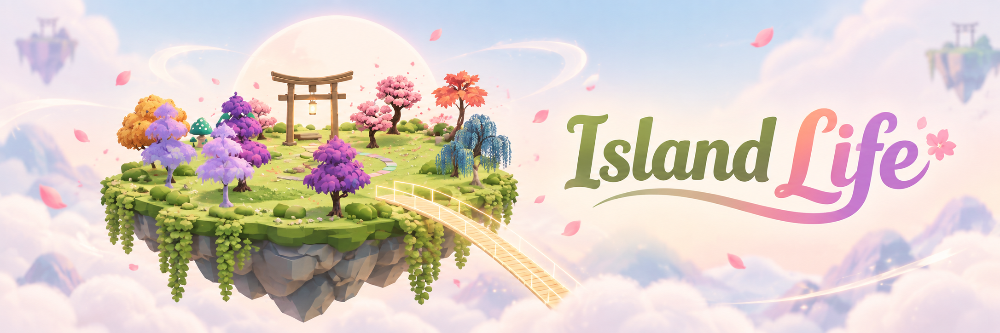</a>
  <br/><br/>
  <a href="docs/videos/sky-neighbourhood.mp4">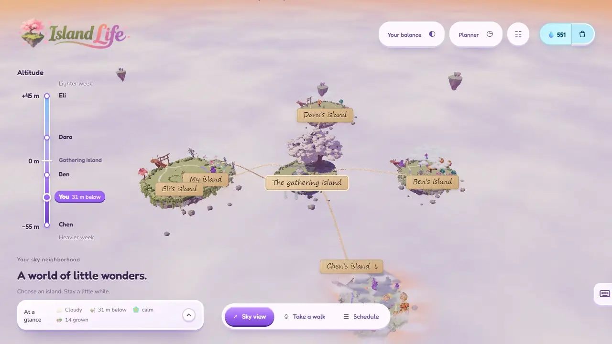</a>
  <br/><sub>Your sky neighbourhood, a full turn &nbsp;·&nbsp; <a href="docs/videos/sky-neighbourhood.mp4">full clip</a></sub>
  <br/><br/>
  <a href="docs/videos/bridge-crossing.mp4">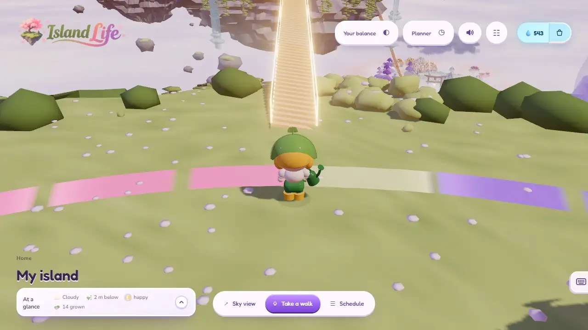</a>
  <br/><sub>Crossing to The Gathering Island &nbsp;·&nbsp; <a href="docs/videos/bridge-crossing.mp4">full clip</a></sub>
</p>

**Team:** Codenected  
**Team Members:** Lee Kai Hong, Leow Shen En, Choong Zhuo Lin, Chung Jun  
**Problem Statement:** Stress & Workload Manager

## Project Links

- **Live app:** [https://island-life-r21r.vercel.app/](https://island-life-r21r.vercel.app/)
- **Instant demo, no account:** [https://island-life-r21r.vercel.app/?enter=demo](https://island-life-r21r.vercel.app/?enter=demo)
- **User guide for judges:** [USER_GUIDE.md](USER_GUIDE.md)
- **Video Presentation:** [https://www.youtube.com/watch?v=IwbC7wqz-7Q](https://www.youtube.com/watch?v=IwbC7wqz-7Q)
- **Presentation Slides:** [https://canva.link/7yl54f1zapatoy0](https://canva.link/7yl54f1zapatoy0)

## Island Life in 30 seconds

**Your week becomes an island.** The product turns a student's schedule, mood, and social support into a small 3D world that can be understood quickly.

|  | 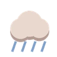 | 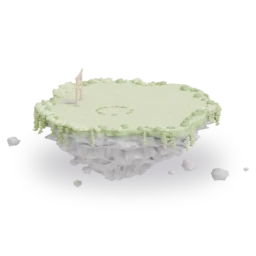 |  | 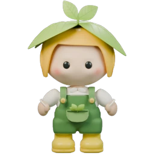 |
|:---:|:---:|:---:|:---:|:---:|
| Activities become trees | Mood becomes weather | Workload controls altitude | Friends connect without seeing your calendar | Your gardener avatar suggests rest when the week looks heavy |

**New since the preliminary round**

- **Check-ins live in the world.** A flower by your gate asks how you feel. A fairy flies out of each finished activity's tree to ask how draining it was, and your island learns what a heavy week means *for you*. See [Checking in, inside the world](#checking-in-inside-the-world).
- **Real accounts and real friends.** Sign in with email or Google, share a sky with up to four friends, connect Google Calendar, and get phone notifications when the golden window opens. See [Your own sky, with your real friends](#your-own-sky-with-your-real-friends).
- **A dewdrop shop.** Grow decorations on your island and dress Blomy, your gardener. See [Dewdrops, spent on your island](#dewdrops-spent-on-your-island).
- **A world that feels alive.** Blomy waters each finished tree, a star whale brings her home on the welcome page, there is music and sound, and the app works on a phone with a touch joystick. See [Arrival, sound and phone](#arrival-sound-and-phone).


# 1. Project Overview

## 1.1 Problem

Today’s university students are often overcommitted. A normal week can include:

- Demanding academics
- Co-curricular leadership
- Sports
- Part-time jobs
- Social lives

Saying **yes to everything** is how it starts. Students end up busy from morning to night, and still feel they have got nothing done.

Most productivity tools do not show that load very well:

- Standard **Pomodoro timers** count down time, but they do not know whether the student is tired, overloaded, or running out of room.
- Energy-tracking apps such as **Pensus** track useful signals, but the result often feels clinical: numbers, logs, and charts instead of something a student wants to return to.

That leaves three groups with a problem:

1. **Gen Z university students**
   - Need visual tools that feel personal.
   - Need better ways to manage their mental bandwidth.

2. **Peer groups**
   - Need a way to notice when a friend may be having a heavy week, without reading that friend's private schedule.

3. **University support networks**
   - Deal with the fallout when stress becomes a crisis.

**Island Life** shows that load instead. A student's week becomes a small floating island they can read in one glance, and friends can see when someone may need support without seeing a single entry in their calendar.


## 1.2 Our Solution

Island Life turns a student's week into a floating **3D island** that makes overload visible earlier.  

Island Life

- Converts scheduled commitments across **seven activity categories** into growing trees, imported from **Google Calendar** or added in its own planner.
- Uses the island’s physical **altitude** to show how heavy the week is *for you*, against your own normal week.
- Asks how draining each finished activity was, through a **fairy** that flies out of its tree, so the island learns what each kind of time costs you.
- Turns emotional check-ins with the **flower by your gate** into the island's **weather**.
- Uses a **gardener avatar** to suggest a single-tap change at a free time, rather than enforcing rigid study marathons.
- Opens a daily **2-minute "Golden Window"** where friends share one unedited photo of what they are doing, with a phone notification when it opens.
- Connects peer islands through **privacy-first bridges** that display emotional weather rather than private calendars.
- Replaces streak penalties with a guilt-free **"Let Go"** mechanic.
- Values and rewards **rest equally with work**, with **dewdrops** that can only be spent on decorations and costumes.

Island Life makes a heavy week visible early, and makes doing something about it a single tap.


# 2. Ideation & Process

## 2.1 Ideas We Considered

These were the main ideas we tested, kept, changed, or dropped.

| Idea | Decision | Why |
|---|:---:|---|
| **Personalized 3D Island World (3D Sky Island)** | **Chosen** | A dashboard made the week feel like homework. A floating island let us show the same data physically: height for load, weather for mood, trees for planned time. |
| **1-Tap Photo Check-Ins ("The Golden Window")** | **Chosen** | We liked the honesty of BeReal: one quick photo of what is happening now. The photos sit on The Gathering Island carousel, so the group sees real moments instead of fake focus timers. |
| **Shared Peer Bridges & Gathering Island** | **Chosen** | Bridges gave the social part a shape. Friends can see weather, altitude, notes, and shared tasks, but not the private details of someone else's plan. |
| **AI-assisted gardener avatar** | **Chosen** | The gardener avatar watches mood check-ins and weekly load. Clear rules decide when it speaks and what kind of help fits. Gemini reads a summary of the week and suggests the idea, choosing only from free times the app has found, and the app checks it before showing it. If Gemini is unavailable, the app's own ideas take over: an early night, a walk, tea with a friend, or a slow evening. |
| **Guilt-Free "Let Go" & Balanced Rewards** | **Chosen** | We did not want streaks or dead trees. If you let go of a task, its glass tree drifts away. Rest earns the same reward as studying: **Dewdrops 💧**. |
| **Visual Activity Trees & Timetable Clock Path** | **Chosen** | Each activity type became its own tree, so a study-heavy week looks different from a social-heavy one. Today's plan became a clock-face path with a light walking through it. |
| **Blender MCP Server Pipeline** | **Chosen** | We needed a lot of matching 3D assets quickly. Python scripts controlling Blender let us regenerate islands, trees, props, and renders after changes. |
| **Bee Colony & Honeycomb World** | **Dropped** | An alternative way to draw the same data: a honeycomb whose cells fill as the week fills, and nectar earned by turning up for the group. It mapped cleanly, but the team found it busier and more industrious than the floating island, and the calmer world suited an app about not overworking. |
| **One Mascot Per Member** | **Reshaped** | Early idea of a personal creature for each student. It became one gardener avatar, Blomy, who tends your island. Costumes came later as a reward in the dewdrop shop, so the world stays readable rather than crowded. |
| **Forest-Style Single-Player Tree Planting** | **Dropped** | Forest depends on a timer, and a timer can reward someone for leaving a phone alone while doing nothing. Killing trees for stopping early also felt wrong for a burnout project. |
| **Crypto-Reward / Tokenomics Concept** | **Dropped** | Mentor Zach advised us to drop it. Crypto rewards are common in hackathon pitches, add friction, and pull attention away from the wellness idea. |
| **Traditional Virtual Garden Concept** | **Dropped** | Mentor Zach also challenged the garden idea because it felt too familiar. The sky island kept the calm feeling but made the data clearer: altitude, weather, trees, and bridges each mean something. |
| **Audio Analysis & Automated AI Pathfinder** | **Dropped** | Audio tracking felt too invasive. We also did not want the app to pretend it knew the perfect schedule when mood and priority are easy to misread. |


## 2.2 Ideation Boards

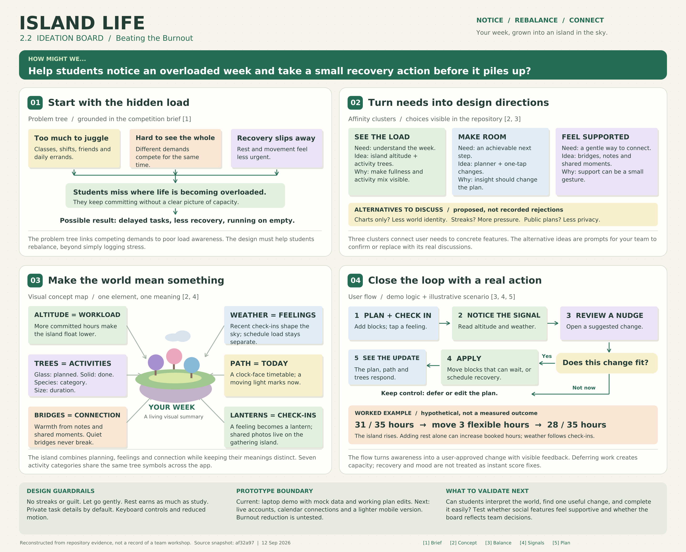


Our ideation process turns hidden workload into something students can see and act on. Island altitude, weather, trees, and bridges show workload, feelings, activities, and social support. Students notice overload early, while small changes still fix it.


## 2.3 How the Idea Evolved

The idea changed in stages. Each meeting helped us remove something, keep something, or make the product clearer.

<p align="left">
  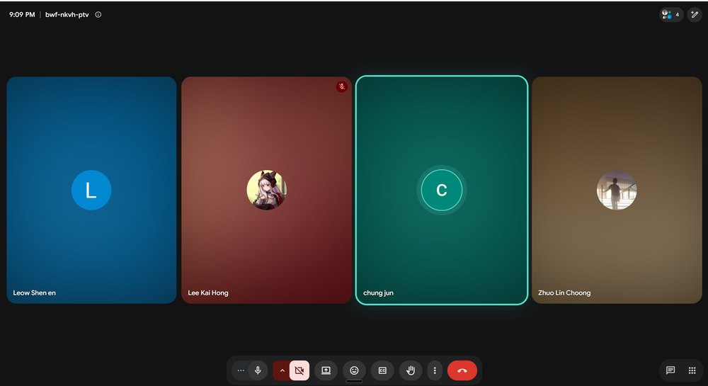
  <br/><sub>Leow Shen En, Lee Kai Hong, Chung Jun and Choong Zhuo Lin, on one of the working calls</sub>
</p>

### 1 September, first meeting: from a dashboard to a community

We started by breaking down the problem statement. The first ideas were simple: a timetable, a workload dashboard, and a chart of hours. They answered the brief, but felt too close to tools students already know.

The direction changed when **Chung Jun** suggested a BeReal-style check-in, where each member shares one photo of what they are actually doing. That made the product feel less like a private tracker and more like something a group could use together.

From there, we discussed group tasks, shared rewards, guide characters, and small rituals that happen at the same time for everyone. By the end of the meeting, two ideas were worth testing further:

- **Community support**, because friends can notice stress early.
- **A 3D world**, because workload is easier to understand when it has a visible shape.

### 5 September, mentorship: cutting what was generic

We took those ideas to the mentor session, which is recorded in 2.4. The main value of that session was narrowing the idea down. The virtual-garden and crypto-reward concepts felt too familiar, so we dropped them.

The BeReal-style check-in and the 3D world stayed. Zach also suggested using an MCP server to control Blender, which made custom 3D assets possible within the time we had.

That left one main question: if the product is a 3D world, what should the world show? A single tree growing on a timer was not enough.

### 7 September, second meeting: two worlds, one vote

**Choong Zhuo Lin** brought two possible world models. Both could carry real workload and mood data.

| | **Floating island** | **Bee colony** |
|---|---|---|
| Time and load | The island rises and sinks with the week | Honeycomb cells fill as the week fills |
| Activities | One tree species per kind of activity | Cells grouped by kind of work |
| Feelings | Weather over your own island | Colour of the hive |
| Community | Bridges to friends' islands | Nectar earned by showing up for the group |

Both models worked, but the island fit the product better. The bee colony felt too busy for an app about overwork. The island felt calmer, belonged clearly to one person, and still worked socially because separate islands can connect into a neighbourhood.

The mapping we chose that day is still the one in the product: **altitude is load, weather is feeling, trees are activities, bridges are friends.**

### 9 to 12 September, building: the decisions that shaped it

Thirty-six commits over three days. These were the main product decisions during the build.

| Decision | Why we made it | What we turned down |
|---|---|---|
| **Scripted asset generation** | Seven tree species, four islands, a character and every prop had to exist in three days and still look like one place. Python driving Blender means any of them can be regenerated after a change. | An asset pack, which would have looked like everyone else's, or modelling by hand, which we could not have finished. |
| **Manual completion** | Today, a tree takes root only when you press Done. This is the whole difference from a timer that rewards a phone left face-down on a desk. Earlier days settle on their own: whatever you didn't let go counts as done, so connecting a calendar on a Thursday grows Monday to Wednesday at once, and nobody has to tap through a backlog. | Growth on a schedule, which would have filled the island by itself and meant nothing. |
| **World-based onboarding** | The landing page is the world itself, with signposts you walk up to, so the first thing a student does is move rather than dismiss an overlay. | A tour or tooltip sequence, which most people skip anyway. |
| **Active rest reminder** | The rest suggestion first sat on a sign by the windmill, and a nudge that waits to be found is not a nudge. Your gardener avatar now speaks when you get home, and the sign keeps the offer. | A passive signpost, which would make the reminder too easy to miss when someone is already tired. |
| **User-confirmed scheduling** | Taking a suggestion used to put a slow evening on your plan at a time we chose. Now it offers free times, or hands you the planner. | Deciding someone's evening for them, which is the behaviour students already resent in productivity apps. |

### 5 to 13 October, from prototype to product

The building phase turned the prototype into something a stranger can use with their own week. These were the decisions that changed it most.

| Decision | Why we made it | What we turned down |
|---|---|---|
| **Real accounts, skies of five** | A demo that forgets you on refresh cannot be piloted. A sky is you and up to four friends, joined with an invite code, and friends only ever receive derived values: weather, lanterns, height, and the kind and size of what you share. | Open friend lists and follower counts, which invite comparison. |
| **Altitude that learns** | The same lecture is easy for one student and draining for another. One tap on "How draining was it?" teaches the island what an hour of each kind costs *you*, so the island compares this week with your own normal week. The method is written up in [docs/algorithm.md](docs/algorithm.md). | One fixed weight per category, which would call the same week heavy for everyone. |
| **Questions inside the world** | The check-in moved from a header button to a flower by your gate, and the drain question from a pop-up to a fairy who flies out of the tree you just grew. Each question now lives where it is about. | Forms and modal dialogs, which feel like homework. |
| **Watering before a tree takes root** | Finishing something should feel like a moment. When you press Done on your island, Blomy walks over with her can and waters the glass tree. From the planner it takes root at once, so a backlog stays quick. | A colour change alone, which made finishing feel like ticking a box. |
| **A shop that only decorates** | Dewdrops buy decorations and costumes, never anything that changes your workload, and they can only be earned by living the week. | Buying dewdrops, timers, or limited-time pressure. |
| **Google Calendar, read first** | Most students already keep their timetable there. Import is read-only. Two-way sync is opt-in and writes only to a separate calendar named "Island Life". | Writing into the student's own calendars. |

## 2.4 Mentor Consultation

<p align="left">
  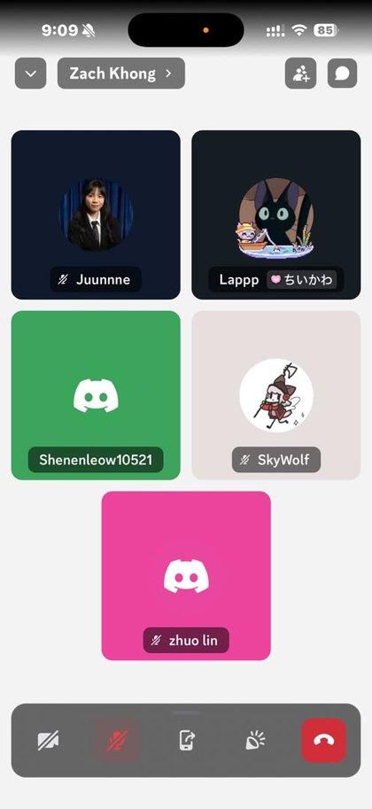
  <br/><sub>The session with Zach Khong, 5 September</sub>
</p>

| Date | Mentor | Feedback Received | What Was Changed |
|---|---|---|---|
| **5 Sept 2026** | **Zach Khong** | Zach told us the virtual garden and crypto reward ideas sounded too familiar. The parts he pushed us to keep were the BeReal-style photo check-in and the 3D island, because those gave the project a clearer social and visual identity. He also suggested driving Blender through an **MCP server**, then rendering the result in **Three.js**, so we could make custom assets without modelling everything by hand. | We dropped the crypto and generic garden directions. The product became a set of connected sky islands instead of a single-player task garden. We used Blender scripts for the island, trees, gardener, props, and renders, then used **Three.js** in the browser. We also studied **Opal**, **Operator/Uplift**, **Pensus**, and Pomodoro tools, mainly to decide what to avoid: fake timers, guilt loops, dry logs, and schedules that pretend to know too much. |


# 3. Design & Prototype

## 3.1 Prototype

**Live app:** [https://island-life-r21r.vercel.app/](https://island-life-r21r.vercel.app/) &nbsp;·&nbsp; **Instant demo, no account:** [?enter=demo](https://island-life-r21r.vercel.app/?enter=demo) &nbsp;·&nbsp; **A route through it:** [USER_GUIDE.md](USER_GUIDE.md)

The demo sky is Aisha's week and her four friends. It runs entirely in the browser, with no account, camera, or calendar needed.

---

### Your week, as an island

<table>
<tr>
<td width="50%"><a href="docs/videos/watering-trees.mp4">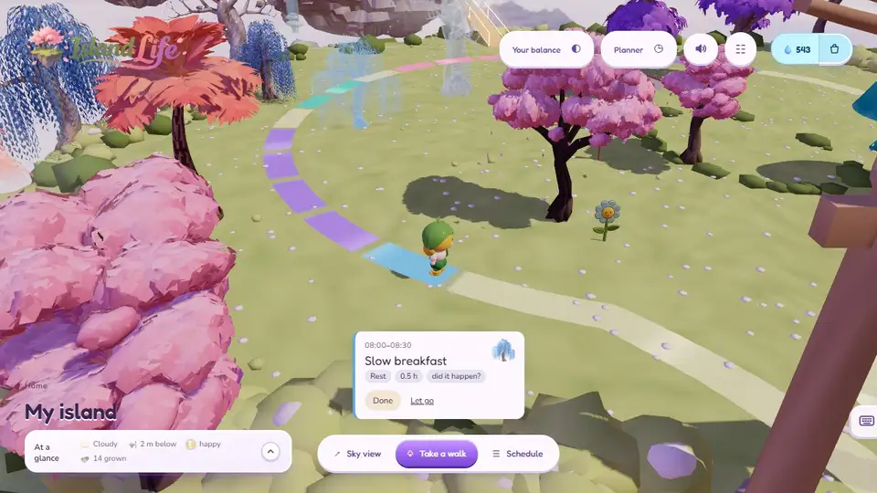</a><br/><sub>Press Done, and Blomy waters the glass tree until it takes root &nbsp;·&nbsp; <a href="docs/videos/watering-trees.mp4">full clip</a></sub></td>
<td width="50%"><a href="docs/videos/island-sinking.mp4">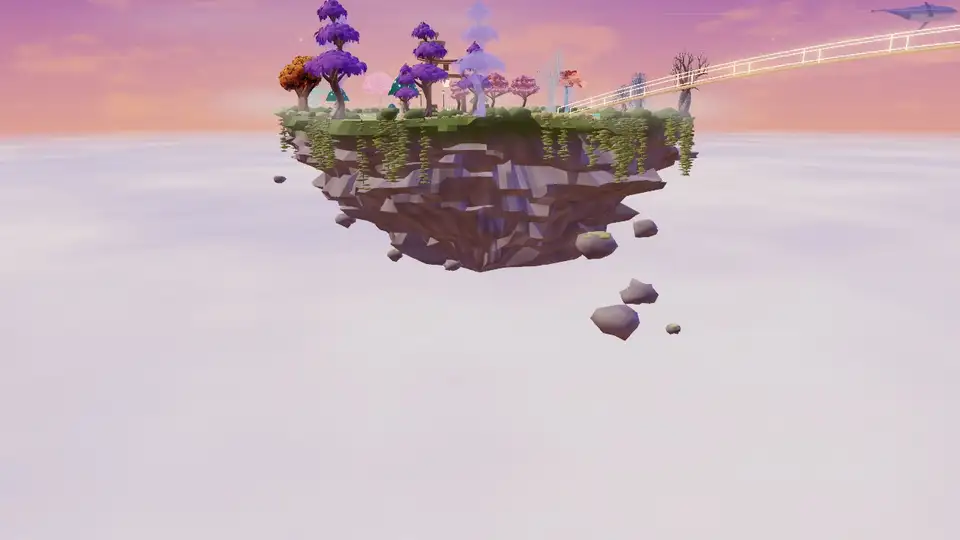</a><br/><sub>The island sinks as the week fills up &nbsp;·&nbsp; <a href="docs/videos/island-sinking.mp4">full clip</a></sub></td>
</tr>
<tr>
<td valign="top"><h3>Everything you do grows into a tree</h3>
Seven kinds of activity, seven kinds of tree. What's coming up stands as a glass tree. When its time has passed, press Done on its stop along the path, and Blomy walks over with her watering can until it takes root in full colour. Let it go, and the glass tree drifts away quietly. Every Monday the island starts fresh, and the weeks before wait under Past weeks.</td>
<td valign="top"><h3>A heavy week sinks your island</h3>
In a normal week for you, your island floats level with The Gathering Island. Lighter weeks rise as high as 45 m, and heavier ones sink toward the cloud sea, down to 55 m below. "Heavy" means heavy for you: the island learns what each kind of activity costs you, and the planner marks heavy days before they arrive.</td>
</tr>
<tr>
<td><a href="docs/videos/weather-rain.mp4">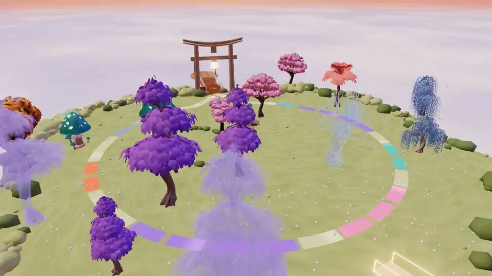</a><br/><sub>Heavy days gather cloud, then rain &nbsp;·&nbsp; <a href="docs/videos/weather-rain.mp4">full clip</a></sub></td>
<td><a href="docs/videos/visit-friend.mp4">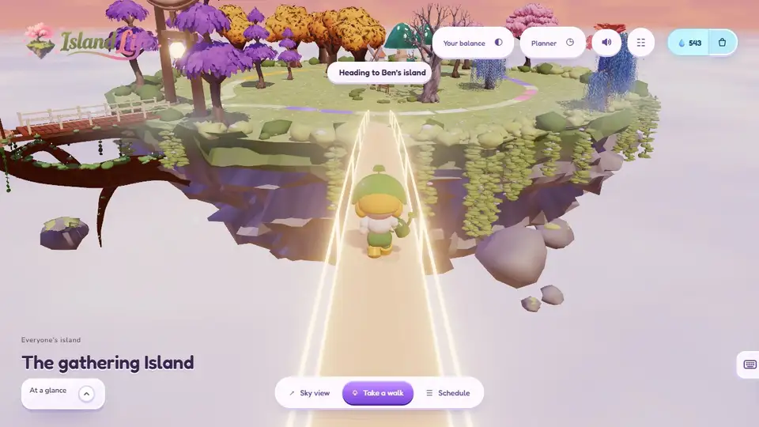</a><br/><sub>Cross a bridge to a friend's island &nbsp;·&nbsp; <a href="docs/videos/visit-friend.mp4">full clip</a></sub></td>
</tr>
<tr>
<td valign="top"><h3>Your feelings become the weather</h3>
Tell your flower how you feel, and a coloured lantern lights up on your pier. A few tired, stressed or low days gather cloud, then rain. Calm and happy days clear it again. The weather is never predicted, and never compared with your normal week.</td>
<td valign="top"><h3>Your friends are a bridge away</h3>
Friends' islands connect to yours through The Gathering Island. Walk onto a bridge and press Go. On arrival you see their weather and how high they float, in words, never their hours or plans. A rainy island is your cue to leave a note at their gate.</td>
</tr>
</table>

|  |  |  |  |  |  |  |
|:---:|:---:|:---:|:---:|:---:|:---:|:---:|
| Study | Work | Errands | Social | Exercise | Rest | Other |

The same little trees mark each kind of activity everywhere in the app, so you can spot a study-heavy week from across the sky.

**How you feel** hangs as a lantern on your pier, one colour per feeling.

| 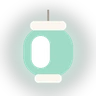 |  |  |  |  |
|:---:|:---:|:---:|:---:|:---:|
| Calm | Happy | Tired | Stressed | Low |

**Your sky** then clouds over or clears, following those lanterns across the week.

|  | 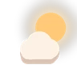 |  |  |  |
|:---:|:---:|:---:|:---:|:---:|
| Clear | Light cloud | Cloudy | Drizzle | Rain |

---

### Checking in, inside the world

Two short questions, each asked by someone who lives on your island. Questions about *you* change the sky. Questions about *things* move the island.

<table>
<tr>
<td width="50%"><a href="docs/videos/flower.mp4">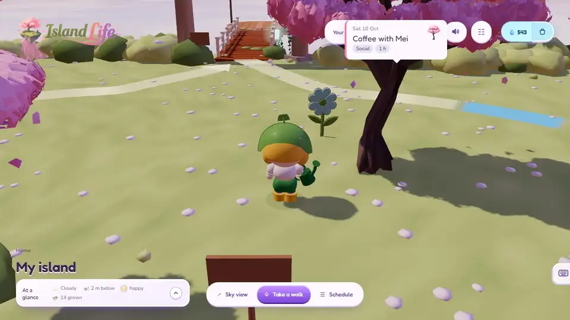</a><br/><sub>Walk up to your flower, and she asks how you feel &nbsp;·&nbsp; <a href="docs/videos/flower.mp4">full clip</a></sub></td>
<td width="50%"><a href="docs/videos/fairy.mp4">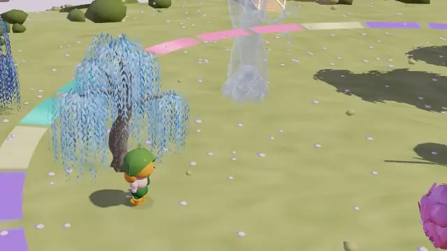</a><br/><sub>A fairy flies out of the new tree with one question &nbsp;·&nbsp; <a href="docs/videos/fairy.mp4">full clip</a></sub></td>
</tr>
<tr>
<td valign="top"><b>Your flower asks how you feel.</b> A flower grows just inside your gate. Walk up to her, tap her, or press T, and she asks how you feel right now: Calm, Happy, Tired, Stressed or Low, with an optional photo. Your answer lights a lantern on your pier and colours her petals. Over a few days the lanterns make your island's weather. Then she rests for an hour. Signed in, she also asks once in the evening by phone notification.</td>
<td valign="top"><b>A fairy asks how draining it was.</b> Every time you finish something, a fairy flies out of its tree and asks one question: Light, Okay or Draining. One tap teaches your island what that kind of time costs you, so a heavy week means heavy <i>for you</i>. Your balance shows what it has learned. Friends never see these answers.</td>
</tr>
</table>

---

### A nudge before you burn out

Burnout creeps up, so Island Life watches for it. When your week gets heavier than usual, a day ahead looks heavy, or your check-ins keep coming back tired, stressed or low, it nudges you on its own, with one idea that fits your week.

<table>
<tr>
<td width="50%"><a href="docs/videos/gardener-nudge.mp4">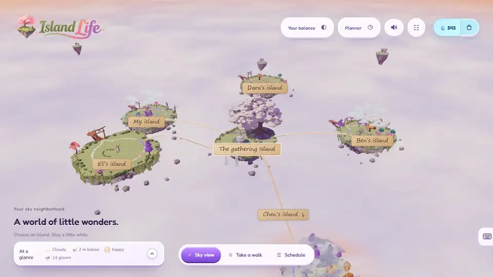</a><br/><sub>Blomy speaks up when you get home, and you pick a time &nbsp;·&nbsp; <a href="docs/videos/gardener-nudge.mp4">full clip</a></sub></td>
<td width="50%"></td>
</tr>
<tr>
<td valign="top"><b>Your gardener avatar speaks up.</b> The moment you get home, Blomy offers one idea: move something you marked <i>can wait</i> to next week, an early night, a walk, tea with the friend you've seen least, or a slow evening. Say yes and choose between two free times, or pick your own in the planner. Nothing lands on your plan until you choose. Ask for another idea, say not now, or press See why. If your sky has been grey for two weeks, she points you gently to real support instead.</td>
<td valign="top"><b>Your balance.</b> How full the week is for you, five areas in plain words (time, mental, physical, social and errands), and small changes that apply in one tap, like pushing a block you marked "can wait" to next week. Below them are how much is done and what your island has learned from your answers. <b>Show your stats</b> opens where your time goes and how you've felt.</td>
</tr>
</table>

---

### Dewdrops, spent on your island

<table>
<tr>
<td width="50%"><a href="docs/videos/shop.mp4">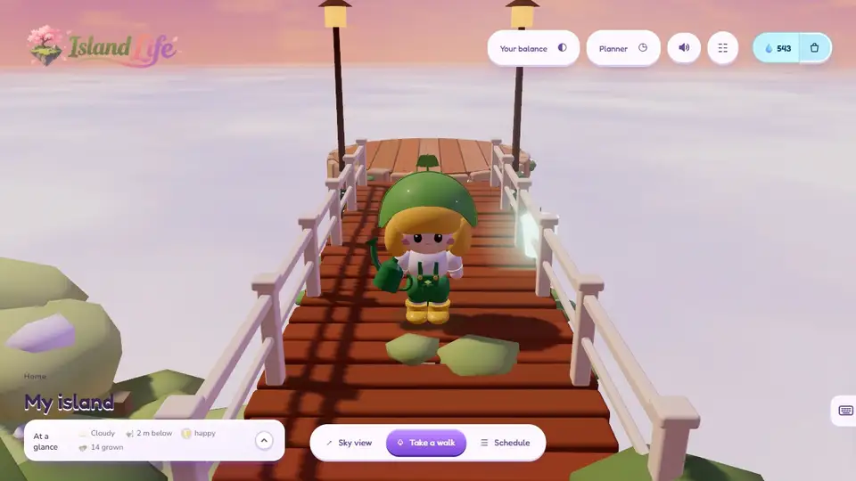</a><br/><sub>A straw sun hat for Blomy &nbsp;·&nbsp; <a href="docs/videos/shop.mp4">full clip</a></sub></td>
<td width="50%"></td>
</tr>
<tr>
<td colspan="2" valign="top">Dewdrops drip in from finished blocks, golden-window moments, notes between friends and shared tasks, and a finished rest block earns the same as a finished study block. Spend them on things that grow by your windmill (a flower bed, a garden bench, stone lanterns, a kite or a little well), which friends see when they visit. Or spend them on something for Blomy to wear: a flower scarf, a ribbon bow or a straw sun hat. Tap one you own to put it on or take it off. Dewdrops can't be bought, and nothing in the shop touches your workload.</td>
</tr>
</table>

---

### And the little moments

<table>
<tr>
<td>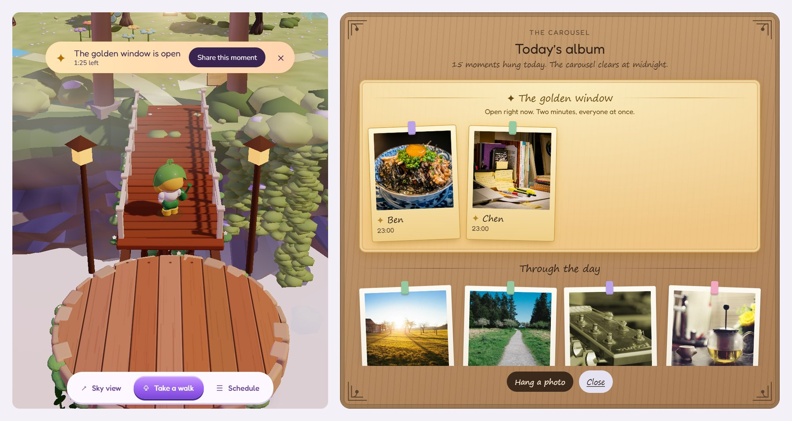</td>
<td>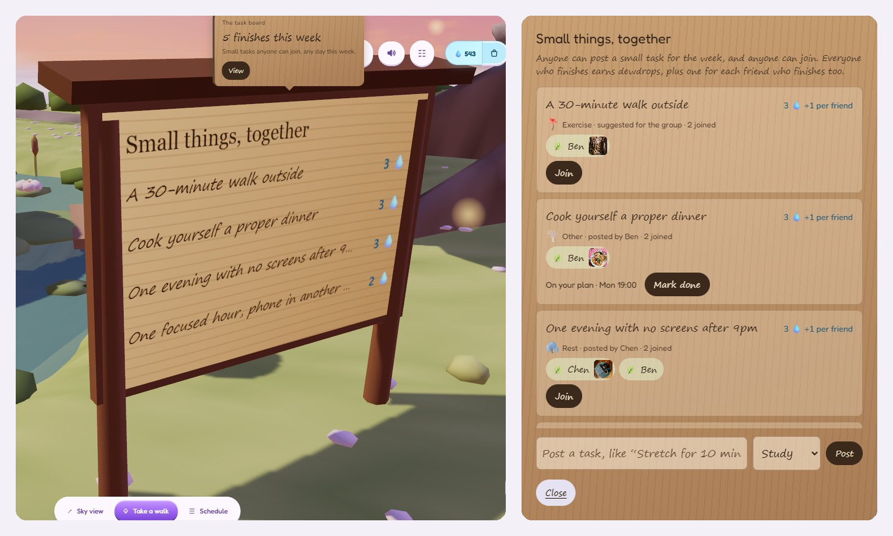</td>
</tr>
<tr>
<td valign="top"><b>The golden window.</b> Once a day, everyone gets two minutes to share one photo of right now, with a notification on your phone the minute it opens. The photos hang on the carousel on The Gathering Island, and the day's album keeps them all.</td>
<td valign="top"><b>Small things, together.</b> Anyone can post a small task, like a walk outside or an evening with no screens, on the board by the pond. You earn more when friends finish too.</td>
</tr>
</table>

- **Today is a path.** Your day is a glowing path laid out like a clock face, and a little light walks it in real time. **Schedule** lifts it into a timeline you can read at a glance.
- **Notes wait at your gate.** Friends leave a few words on a wooden sign, and you read them when you get home.
- **A planner that feels normal.** Day, week and month views, drag to add, move and resize, blocks that repeat weekly, Done, and a guilt-free Let go. Each day is marked light, usual or heavy for you.
- **Past weeks.** Every Monday your island starts fresh, and you can walk back through the islands of the weeks before.

---

### Your own sky, with your real friends

<p align="center">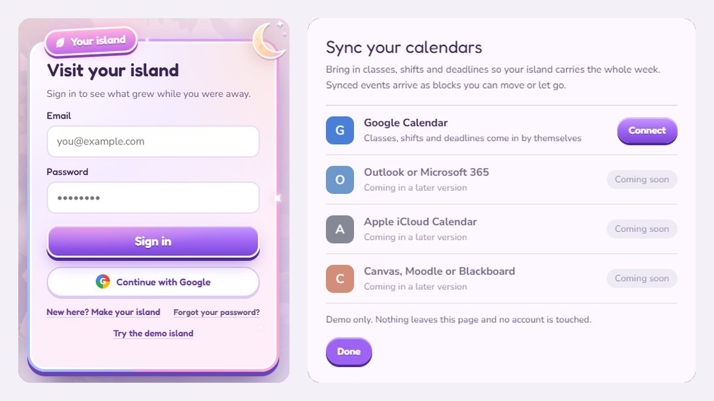</p>

- **Sign in** with email or Google. A **sky** is you and up to four friends: start one and share the invite link, or join a friend's with their code.
- **Google Calendar** brings in classes, shifts and deadlines, and re-syncs every three hours. Import is read-only. Two-way sync is off by default, and when on it writes only to a separate calendar named "Island Life". Outlook, iCloud and Canvas or Moodle feeds are marked *coming soon*.
- **Live with friends.** Check-ins, notes, tasks, photos and decorations arrive on friends' islands as they happen.
- **Phone notifications**, if you allow them: the golden window the minute it opens, one "How are you?" in the evening, and "How draining was that?" after an activity, never between 22:00 and 08:00.

---

### Arrival, sound and phone

<table>
<tr>
<td width="50%"><a href="docs/videos/welcome.mp4">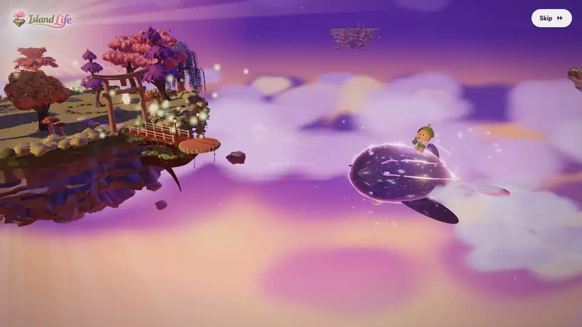</a><br/><sub>A star whale brings Blomy home &nbsp;·&nbsp; <a href="docs/videos/welcome.mp4">full clip</a></sub></td>
<td width="50%"></td>
</tr>
<tr>
<td valign="top"><b>A welcome, not a form.</b> The first visit opens with a star whale carrying Blomy through the clouds to your pier. Come ashore to sign in or try the demo, or skip it. Blomy then shows you round your island once, and you can bring the guide back from the menu.</td>
<td valign="top"><b>On a phone.</b> A touch joystick to walk and a second finger to look around, the same planner and balance as on desktop, and a lighter render for weaker devices. It can be installed to the home screen. Calm background music and small sounds (footsteps that change on wood, grass, stone and water, rain, the watering can) each have their own volume.</td>
</tr>
</table>

---

### Design choices

- **No streaks, no guilt.** Letting go of a plan is fine. Its glass tree drifts away and stops counting this week. You can bring it back any time.
- **It rewards balance, not hustle.** A finished rest block earns the same as a finished study block, and dewdrops only ever decorate.
- **Private by default.** Friends see your weather, your lanterns, and how high you float, in words. Your hours, plans and "How draining was it?" answers stay yours. For each block, you choose whether friends see the whole thing, only its kind and size, or nothing.
- **AI suggests, rules decide.** Gemini only sorts imported event titles into kinds, and suggests and words the gardener's idea from options the app offers and then checks. Every number on the island comes from plain arithmetic.


## 3.2 How it works

Every part of the world is driven by something the student did, not by decoration. The full method, with its references, is in [docs/algorithm.md](docs/algorithm.md), and the research behind it in plain words is in [docs/science.md](docs/science.md).

<details>
<summary><b>The full mapping, element by element</b></summary>

| In the world | What it means | What drives it |
|---|---|---|
| **Altitude** | How heavy this week is for you | This week's load (hours × how draining each kind of activity is for you) against your own normal week. A normal week sits level with The Gathering Island; lighter weeks rise to 45 m, heavier ones sink to 55 m below, into the cloud sea. |
| **Weather** | How you've been feeling | Your check-ins this week, with recent days counting for more. Tired, stressed and low bring cloud and rain. Calm and happy clear it. |
| **The flower by your gate** | Today's check-in | Droops until you check in, then takes the colour of your feeling |
| **The fairy** | How draining an activity was | Your Light, Okay or Draining answer after you finish something. It teaches altitude, never the weather. |
| **Glass trees** | What's coming up | Future blocks, one species per kind of activity |
| **Solid trees** | What you did this week | Today's blocks you marked Done, and earlier days' blocks you didn't let go. Fresh every Monday. |
| **Glowing path** | Today's timetable | Your blocks from 07:00 to 22:00, laid out like a clock face |
| **The light on the path** | Right now | It walks the path in real time |
| **Lanterns on your pier** | Your feelings | Each check-in you make this week |
| **Bridge glow** | Warmth with your friends | Notes, shared moments, visits and time together |
| **Carousel photos** | The day's shared moments | One photo per person from the golden window, plus moments through the day |
| **Decorations and costumes** | What you chose to grow | Dewdrops spent in the shop |
| **Dewdrops** 💧 | A gentle reward | Done blocks, notes, moments and group tasks |

</details>

**Rebalancing a heavy week is a loop.** You see the week, the app points out what is too much, you change it, and your island shows the result.

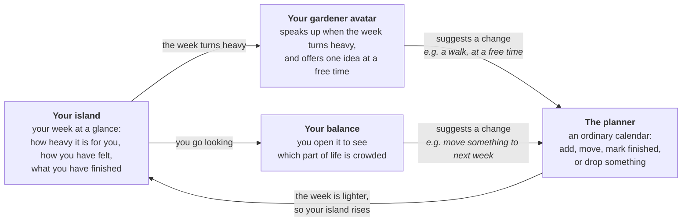

# 4. What Makes It Different

Island Life differs in three ways: the week is read as a **3D place** rather than a chart, the island **speaks up when the week looks heavy for you**, and friends see **how you are without seeing your calendar**.

## Competitive Comparison

| Feature | **Island Life** | **Forest** | **Pensus** | **Pomodoro** | **Operator Uplift** |
|---|---|---|---|---|---|
| **World and visuals** | A 3D island in Three.js. Its height, light, trees, bridges, and weather change with the week. | A top-down 2D forest grid. | Dashboards with numbers, rings, and charts. | A timer, usually with a countdown or progress bar. | Workspace screens with task logs, lists, and feeds. |
| **Optional Photo Check-In** | **1-Tap Photo Check-In.** Share a photo of any moment on the group's carousel, whenever you like. Once a day, BeReal-style, a two-minute golden window opens for everyone at once, with a phone notification. Sharing is optional. | Passive countdown timer. Trees grow even if the phone sits idle on a desk while the user watches TV or sleeps. | Mechanical background timer, with nothing shared with anyone. | Mechanical background timer, with nothing shared with anyone. | Mechanical background timer, with nothing shared with anyone. |
| **Burnout and rest** | The island learns how draining each kind of activity is for you, and the gardener avatar speaks up for heavy weeks or repeated tired, stressed, and low check-ins. Rest can be added in one tap and earns **Dewdrops 💧** too. | Stopping early can kill a tree, which can make a bad study day feel worse. | Tracks energy, but mostly shows it as logs and metrics. | Uses fixed 25/5-minute intervals, even when the student needs a different rhythm. | Focuses on task execution and planning, not emotional load. |
| **Friends** | A private sky of up to five friends. Visit through bridges, see weather and altitude, leave gate notes, and finish small group tasks together. Private calendar details stay hidden. | Mostly single-player. Shared rooms mainly synchronize a timer. | No built-in social space. | No built-in social space. | Team feeds and shared workspaces, built more for work than student wellbeing. |


# 5. Technical Architecture & Feasibility


## 5.1 Tech Stack

Island Life runs in the browser, on desktop and phone, with a **Supabase** backend for accounts, friends, storage, live updates and scheduled work. The demo sky runs entirely in the browser with local data, so it works with no account and no network services.

Everything that decides something is **rule-based**: altitude, weather, forecasts, and which kind of help the gardener offers are plain functions anyone can read and test. **Gemini** is used only where a model is genuinely better: sorting imported event titles into the app's kinds of activity, and suggesting and wording the gardener's idea from the free times and *can wait* blocks the app offers. The app checks every suggestion, and nothing reaches a student's plan until they tap it.
```
Frontend: HTML5 + CSS3 + JavaScript (ES modules) + Three.js + Vite
Backend: Supabase Auth + Data API + Realtime + Storage + Edge Functions + Cron
Database: PostgreSQL with Row-Level Security
AI: Gemini, advisory only, called from Edge Functions
Integrations: Google Calendar API + Web Push
Deployment: Vercel + Supabase
Testing: Node.js Test Runner + Playwright, on GitHub Actions
Asset pipeline: Blender + Python + GLB/glTF, meshopt-compressed
```

### Frontend

| Technology | Role | Reason for Selection | Status |
|---|---|---|---|
| **HTML5** | Defines the interface: navigation, planner sheets, forms, dialogs, and accessibility labels. | The project does not need a UI framework, and plain HTML keeps the screens easy to inspect. | Built |
| **CSS3** | Handles responsive layout for desktop and phone, visual styling, transitions, animations, a UI size setting, and reduced-motion behaviour. | Native CSS gives us enough control for the painterly interface around the 3D world. | Built |
| **JavaScript with ES Modules** | Runs the planner, check-ins, social actions, rewards, the shop, and Three.js scene updates. | ES modules let us split the app into focused files while still running directly in the browser. | Built |
| **Rule-based logic** | Works out this week's load against your own normal week (learned from "How draining was it?" answers), the weather from check-ins, the forecast for each day, and which kind of help to offer. | Rules are enough for counting and comparing, and they can be read and tested. | Built |
| **Three.js** | Renders the islands, trees, bridges, weather, timetable path, Blomy, the flower and the fairy, lighting, and post-processing. | Three.js handles the WebGL work for us, and it can load the GLB files we export from Blender. | Built |
| **GLTFLoader with meshopt** | Loads the compressed island, tree, and decoration models, with lighter copies for distant trees. | Compression took the models from 125 MB to 19 MB, so the world loads on an ordinary connection. | Built |
| **OrbitControls** | Lets users rotate and zoom the camera around the islands and player, alongside keyboard and touch controls. | The controls already feel familiar on mouse and touch, so we did not have to build that layer ourselves. | Built |
| **EffectComposer and UnrealBloomPass** | Adds bloom to paths, bridges, lanterns, and atmospheric lighting. A smoothness governor drops glow and shadow detail before resolution on slower devices. | The glow is part of the visual language, especially for the bridge and timetable path. | Built |
| **Web Audio API** | Plays the background music and sound effects on separate volume controls: footsteps by surface, rain, the watering can, and chimes. | The browser mixes it all with no extra library. | Built |
| **Browser Media APIs** | Opens the user's camera or uploaded images for check-in photos and golden-window moments. | The browser already has the capture tools we need. | Built |
| **Service worker and Web App Manifest** | Receives push notifications and lets the app be installed to a phone's home screen. | Standard web features, with no app store needed. | Built |
| **Vite** | Runs the local dev server, handles ES modules, and builds the welcome page and the app. | It starts quickly and fits a plain JavaScript and Three.js project. | Built |

### 3D Asset Production

| Technology | Role | Reason for Selection | Status |
|---|---|---|---|
| **Blender** | Creates the islands, trees, gardener character, decorations, and rendered interface artwork. | It gives us modelling, materials, lighting, animation, and GLB export in one tool. | Built |
| **Python** | Generates Blender models, renders, inspections, and exports. | Scripts keep the assets repeatable. If a tree shape changes, we can rebuild the set instead of fixing each file by hand. | Built |
| **GLB/glTF, WebP, PNG, JPEG, MP3 and WAV** | Deliver 3D models, icons, character sprites, artwork, photographs, music, and sound effects. | These formats work across modern browsers and keep file sizes reasonable. | Built |

### Backend and Database

| Technology | Role | Reason for Selection | Status |
|---|---|---|---|
| **Supabase** | Backend platform for accounts, data, files, live updates, and server-side work. | It gives the team Postgres, auth, storage, realtime, APIs, and edge functions without running separate services for each one. | Built |
| **PostgreSQL** | Stores profiles, skies, blocks, check-ins, drain answers, island status, notes, shared tasks, golden windows, moments, calendar connections, push subscriptions, prompts, and shop purchases. | The data is relational: friends share a sky, blocks create weekly load, and privacy rules depend on who is asking. | Built |
| **Supabase Auth** | Handles registration, login, password recovery, sessions, and Google sign-in. | Auth records link directly to profile rows and database policies. | Built |
| **Row-Level Security (RLS)** | Keeps private schedules and drain answers visible only to the owner. | Friends read only the summary each owner's app publishes (how far the island sinks, how heavy the sky is), never raw calendar rows. | Built |
| **Supabase Data API** | Lets the browser read and write approved database rows. | The client library fits the JavaScript code and avoids a separate CRUD API. | Built |
| **Supabase Realtime** | Updates friend status, check-ins, notes, shared tasks, carousel photos, and decorations between users. | Friend islands change while people are using the app, without a refresh. | Built |
| **Supabase Storage** | Stores check-in photos, golden-window photos, and task photos. | These files need the same account-based privacy as the rest of the product. | Built |
| **Supabase Edge Functions** | `google-calendar` for calendar OAuth and sync, `gardener` for Gemini, and `prompts` for phone notifications. | API secrets and refresh tokens stay on the server. | Built |
| **Supabase Cron** | Schedules each day's golden window and rings it, re-syncs calendars every three hours, sends prompts every fifteen minutes, and suggests shared tasks each Monday. | Those jobs need to happen even when nobody has the app open. | Built |

### APIs and External Services

| Technology | Role | Reason for Selection | Status |
|---|---|---|---|
| **Google Calendar API** | Imports classes, shifts and deadlines, including repeating events. Optional two-way sync writes only to a separate "Island Life" calendar. | Many students already keep their timetable there. | Built |
| **Gemini API** | Sorts imported event titles into the app's kinds of activity, and suggests and words the gardener's idea. The app checks the choice, and falls back to its own ideas if Gemini is unavailable. | Reading messy event titles and wording a suggestion are what a model does well. | Built |
| **Web Push** | Rings the golden window, asks "How are you?" in the evening, and asks "How draining was that?" after an activity, outside quiet hours. | Reaches the student without an app store. | Built |
| **Microsoft Graph Calendar API** | Connects Outlook, Microsoft 365, and supported university calendars. | This matters for schools that run on Microsoft 365. | Planned, shown as *coming soon* |
| **ICS Calendar Feeds** | Imports coursework and deadlines from Canvas, Moodle, Blackboard, and similar systems. | ICS links are common and need no app approval. | Planned, shown as *coming soon* |
| **CalDAV** | Connects iCloud Calendar and other compatible calendars. | Broader calendar support. | Planned, shown as *coming soon* |
| **Google Classroom API** | Imports coursework due dates from Google Classroom. | Some coursework never reaches the student's personal calendar. | Planned after the final |

### Hosting, Testing, and Delivery

| Technology | Role | Reason for Selection | Status |
|---|---|---|---|
| **Vercel** | Hosts the built welcome page and app. | The built site is static, so Vercel is a simple fit. | Built |
| **Node.js Test Runner** | Runs 25 unit tests for the learned workload, altitude, forecasts, calendar events, the gardener's ideas, and when the island asks. Local suites also check row-level security and the Edge Functions against a local Supabase stack. | Node already includes it, so we can test the core logic without adding another framework. | Built |
| **Playwright** | Runs the judging journey in a real browser: a check-in with the flower, the balance, a suggestion, and the planner. | It runs the same flows a judge or student would click through. | Built |
| **GitHub and GitHub Actions** | Every push and pull request runs the unit tests, a production build, and the browser test. | A broken merge is caught before it reaches the live app. | Built |


---

## 5.2 System Architecture
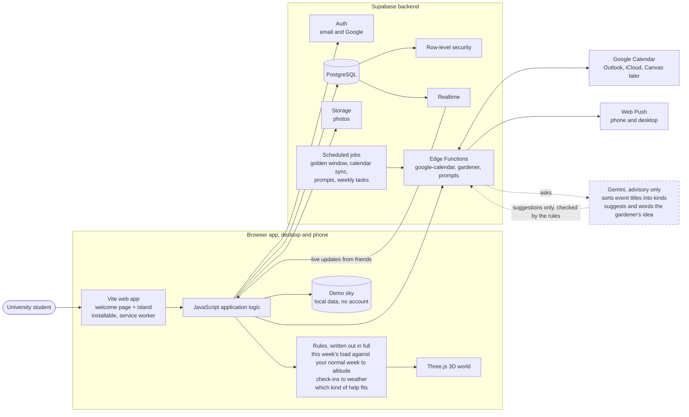

<sub>Source: <a href="docs/architecture.mmd">docs/architecture.mmd</a>. The rules box is the part that decides anything, and it is plain code rather than a model. Gemini is dashed because it only ever advises.</sub>

## 5.3 Build Plan for the Final

The plan follows the competition's own phases. The building phase is done, and the deploy phase has begun.

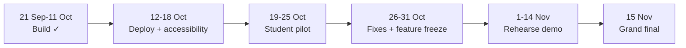

| Window | Focus |
|---|---|
| **21 Sep to 11 Oct** | Building: turn the prototype into something a stranger can use with their own week. **Done.** |
| **12 Oct to 31 Oct** | Deploy: make it fast, reachable, and tested by people who are not us |
| **1 Nov to 14 Nov** | Rehearse: fix what the pilot found and make the demo dependable |
| **15 Nov** | Grand final |

### Done in the building phase

| Area | What we built |
|---|---|
| **Accounts and data** | Supabase project, a schema for profiles, skies, blocks, check-ins, drain answers, notes, tasks, moments and purchases, row-level security, and email and Google sign-in. Plans, check-ins, notes, the task board and the carousel read and write the database and survive a refresh. |
| **Friends for real** | Skies of up to five, joined with an invite link or code. Each island publishes only how far it sinks and how heavy its sky is, so hours and titles never leave the owner's account, and friends' changes arrive live. |
| **Calendar import** | Google Calendar, connected for real: read-only import, repeating events, a re-sync every three hours, and optional two-way sync into a separate calendar. Gemini sorts event titles into kinds. |
| **An island that learns** | "How draining was that?", asked by the fairy and by phone, teaches each student's own normal week. The planner forecasts heavy days, and the gardener chooses between a schedule fix, rest, or support. |
| **Phone pass** | Touch joystick, icon-only header, sheets and the island card laid out for a narrow screen, a UI size setting, and an installable app with push notifications. |
| **Lighter world** | Models compressed from 125 MB to 19 MB, low-detail far trees, merged meshes, and a smoothness governor for weaker devices. |
| **Tests** | 25 unit tests and a browser test of the judging journey, run by GitHub Actions on every push. |
| **Beyond the plan** | The welcome page's star-whale arrival, Blomy's first-time guide, the flower and the fairy, watering, the dewdrop shop and wardrobe, music and sound effects, and golden-window notifications. |

### Deploy, 12 October to 31 October

| Week | What we do | Done when |
|---|---|---|
| **12 to 18 Oct** | **Production deploy.** The live app at [island-life-r21r.vercel.app](https://island-life-r21r.vercel.app/) with the Supabase production project behind it, backups, and error reporting. | A clean visit from the public URL works with no local setup. |
| | **Performance and accessibility.** First-load budget, keyboard path through every screen, visible focus, contrast, reduced motion, and Safari, Firefox and Chrome on desktop and phone. | Every task can be completed without a mouse, and the world holds a steady frame rate on the phones we have. |
| **19 to 25 Oct** | **Pilot with students outside the team.** Around ten of them for a week: connect a calendar, check in daily, answer the fairy, meet one nudge. We watch the first five minutes without explaining anything. | We can say what people misunderstood, and how many connected a calendar, marked something done, and accepted a suggestion. |
| **26 to 31 Oct** | **Fix what the pilot found**, then harden the edges: first run with nothing on the plan, a calendar that fails to connect, a friend who never checks in, and an offline start. | The top issues from the pilot are closed, and no empty state is a blank screen. |
| | **Feature freeze** on 31 October. | Only fixes after this date. |

### Rehearse, 1 to 14 November

A demo that runs from a judge's own calendar, a recorded fallback in case the network fails, and a five-minute script: connect a real timetable, watch the island sink, let the gardener avatar catch it.

### Risks we are planning around

| Risk | What we do about it |
|---|---|
| Calendar providers need app approval before the public can connect | Google Calendar already connects. The planner works with no calendar at all, and Outlook and ICS feeds stay after the final. |
| A 3D world is heavy on cheap phones | Compressed assets and the smoothness governor are in. The pilot tests on a mid-range device rather than ours. |
| Nobody outside the team has used it | The pilot is scheduled inside the deploy window, not left until the end. |
| A live demo depends on the venue network | The demo sky runs on local data with no network services at all. |

## 5.4 Beyond the Final

- **More calendars**: Outlook and Microsoft 365, iCloud, and Canvas or Moodle feeds, all already marked *coming soon* in the sync panel.
- **Hot-air balloons for check-ins**, rising over each island so friends can spot from the sky view who checked in today.
- **Riding the star whale across a bridge**, so the whale that brought Blomy home also carries her to a friend.
- **Gentle milestones**, such as a first week in balance or a first slow evening.

# Summary

**Island Life** is a stress and workload manager that reads as a place rather than a dashboard.

Instead of another timer or checklist, it puts a student's schedule, workload, feelings and rest into one small **3D island** they can see, and it learns what a heavy week means for each student.

The goal is not to help students **do more**. It is to help them see when they are doing **too much**, and to make the next small step easy.

<div align="center">
  <strong>Made by Team Codenected</strong>
  <br>
  <strong><em>© Codenection 2026</em></strong>
</div>
