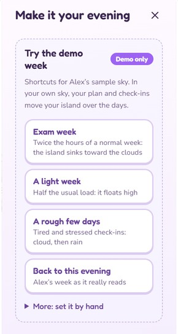
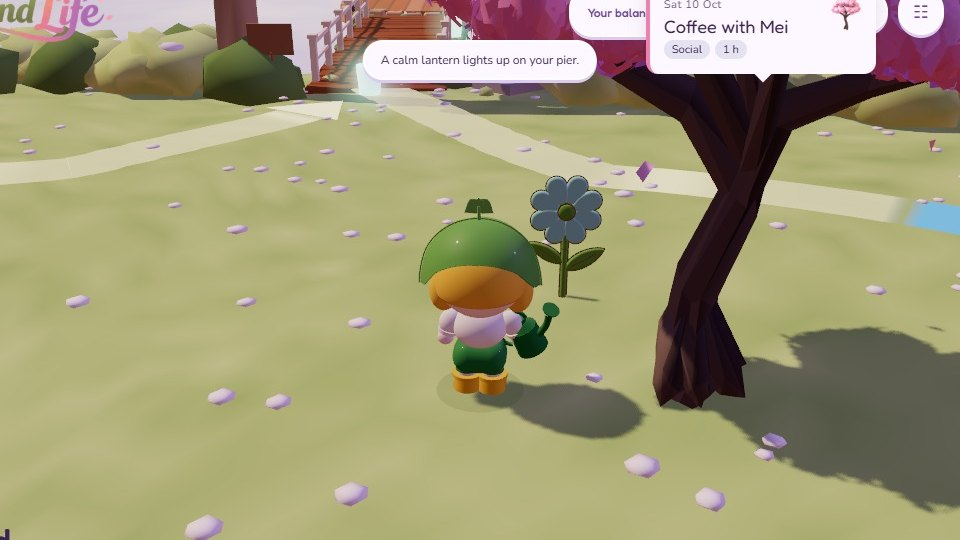
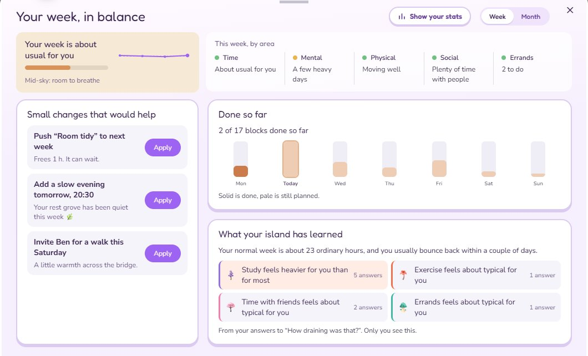
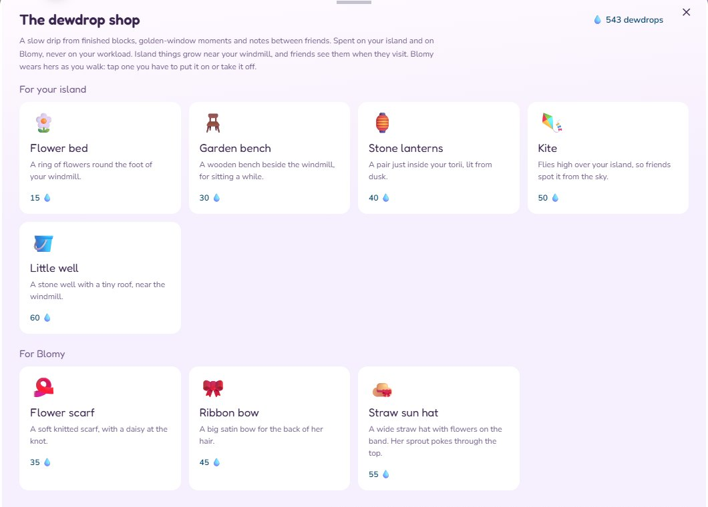
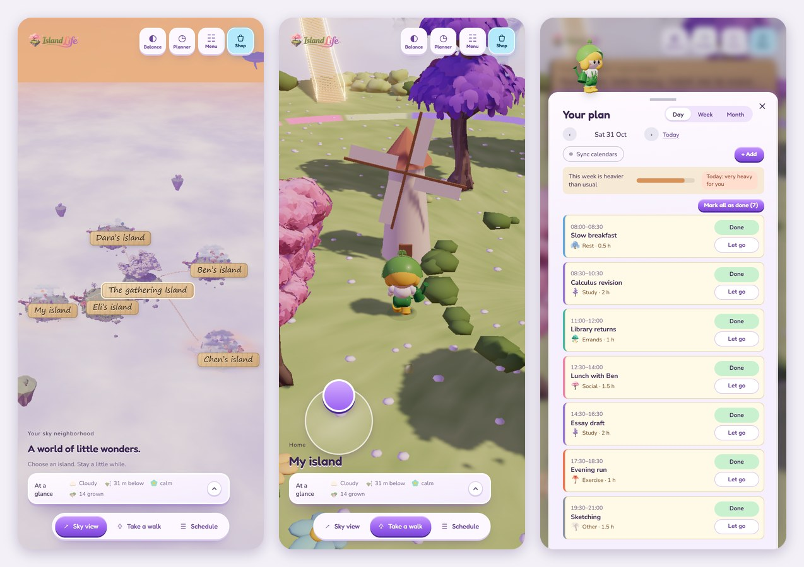

# Island Life — User Guide

Island Life turns a student's timetable and feelings into a floating 3D island. A week that is heavy *for you* makes the island sit lower in the sky, while recent mood check-ins shape its weather. This guide provides a simple route through the main experience.

<!-- Submission owner: before sharing this guide, open both links below in an incognito window and confirm they load. The app now lives at island-life.onrender.com. The older Vercel addresses (island-life-one.vercel.app, which asks for a Vercel login, and island-life-r21r.vercel.app) are not the judging links, so do not use them. Do not commit judge passwords to this file. -->

## Before you begin

- **App:** [https://island-life.onrender.com/](https://island-life.onrender.com/) (opens the welcome page first)
- **Instant demo:** [https://island-life.onrender.com/?enter=demo](https://island-life.onrender.com/?enter=demo) (skips the welcome page and goes straight into the demo sky)
- **Recommended browser:** the latest Chrome or Edge on a laptop or desktop, with the window full-screen. A phone works too; see [On a phone](#on-a-phone).
- **Suggested test time:** 10–12 minutes
- Please allow up to one minute for the 3D world to load on the first visit.
- No account, camera, notification or calendar permission is required for the demo route.
- **Sound:** gentle music and sound effects start after your first click. Use the speaker button at the top to mute.
- **Good to know:** the demo's clock opens in the evening, after the day's activities have passed. Today's blocks therefore read "did it happen?" in the Planner. This is expected.
- **Found a bug or issue?** Please report it on GitHub; see [Report a bug or issue](#report-a-bug-or-issue).

## Choose a route

| Route | Best for | Data used |
| --- | --- | --- |
| **Demo island — recommended first** | Seeing every important feature quickly | Preloaded fictional data for Aisha and four friends; changes remain in this browser only |
| **Signed-in island** | Testing accounts, persistence, private data, invitations, Google Calendar and notifications | A Supabase account and data created by the judge |

## Route A — recommended 10-minute demo

### 1. Enter Aisha's demo sky

Open the [instant demo link](https://island-life.onrender.com/?enter=demo). Alternatively, open the [main app](https://island-life.onrender.com/) and watch a star whale carry Blomy, the gardener, to the pier (or press **Skip** at the top right). Then press **Come ashore** and select **Try the demo island** under the sign-in card.

Wait until the floating islands appear with the message "Welcome to the demo sky. This is Aisha’s island, and her four friends." Blomy then offers a short guided tour.

**What the tour asks you to do:** tap **My island**, hold `W A S D` to walk, walk up to the flower by your gate and pick a feeling, open and close the **Planner**, open and close **Your balance**, and finally walk onto a bridge. Most steps wait until you have done them. You can press **Skip** at any point.

**Expected result:** six labelled islands appear in one shared sky: **My island** (Aisha's), **Ben's**, **Chen's**, **Dara's** and **Eli's island**, around **The gathering Island** in the middle. Aisha's sample timetable, mood history and friends are already loaded.

### 2. See how workload changes the island

1. Open the settings panel with the **☷ icon** at the top right (its tooltip reads "Tune the world"). The panel's heading is **Make it your evening**.
2. Scroll down inside the panel to **Try the demo week**.
3. Select **Exam week** and observe the island sink. The **At a glance** card at the bottom left shows "38 m below" and the sky becomes **Drizzle**.
4. Select **A light week** and observe it float 38 m higher with a clear sky.
5. Select **A rough few days** and observe cloud and rain appear.
6. Select **Back to this evening** to restore the original sample.

Tip: press **Sky view** at the bottom to watch the island move. When you are walking on the island it is harder to see it sink.

**What this demonstrates:** island height represents workload compared with the student's own normal week, and weather represents the recent mood trend. Workload and mood are deliberately kept separate.

### 3. Tell your flower how you feel

1. Go to **My island**: select its label in the sky view, or press **Take a walk** at the bottom.
2. A flower grows just inside your gate, to the left of the path from the pier. Walk up to her, tap her (a small "How do you feel?" tag rides on her face), or press `T`.
3. She asks **How do you feel right now?** Choose **Calm**, **Happy**, **Tired**, **Stressed** or **Low**. **Add a photo** is optional, and **Not now** closes her question.
4. Look for the message "A calm bloom opens beside your flower." and, in the **At a glance** card, the updated feeling and sky.

**Expected result:** the check-in is recorded immediately. One check-in opens a small bloom in that feeling's colour in the bed around her and colours her petals (the bed keeps the last seven days); several recent check-ins gradually change the island's weather. Afterwards she rests for an hour: her tag then reads "Resting · asks again in … min".

### 4. Finish an activity, and meet the fairy

1. Select **Planner**. The **Day** view lists today's activities, each with **Done** and **Let go**.
2. Press **Done** on one of them, for example **Slow breakfast**. Its tree takes root on your island at once.
3. Close the planner. A small fairy flies out of that tree and asks **How draining was it?** Choose **Light**, **Okay** or **Draining** (or **Not now**).
4. Blomy says what the island learned. The answer also shows on that block's row in the Planner.

You can also finish an activity on the island itself: walk along the coloured path until a block's card appears, and press **Done**. Blomy then walks over with her watering can and waters the glass tree until it takes root, before the fairy comes out.

**What this demonstrates:** finishing is always a deliberate tap, never a timer. The fairy's one question teaches the island what each kind of activity costs this student, which is what "heavy *for you*" means. **Your balance** shows what it has learned, and friends never see these answers.

### 5. Inspect and edit the planner

1. Select **Planner**.
2. Switch between **Day**, **Week** and **Month** to inspect Aisha's sample schedule. The bar under the tabs says how full the week is for her, and each day is marked, for example "Today: heavy for you".
3. Select **+ Add a block**.
4. Enter a title (**What**), then choose the **Day**, **Starts**, **For** (duration) and **Kind**. **Friends see** controls how much your friends can see: *Kind and size only*, *Everything*, or *Nothing*. You can also tick **Repeats every week** and **Can wait if the week gets full**.
5. Select **Save**. A message says the block "is on your plan."
6. Switch to **Week** view and confirm that the new block is shown. There you can also drag on empty time to add a block, drag a block to move it, or drag its lower edge to resize it.

Each activity kind has its own tree species. **Done** makes the tree take root in colour; **Let go** makes it drift away without punishment, and it can be brought back from the planner.

### 6. Test active rebalancing

1. Select **Your balance**. The sheet is titled **Your week, in balance**.
2. Review how full the week is, **This week, by area** (Time, Mental, Physical, Social, Errands), **Done so far** and **What your island has learned**. Press **Show your stats** for **Where your time goes** and **How you’ve felt**, then **Back to what you can change**.
3. Under **Small changes that would help**, apply a suggestion with **Apply**, for example **Add a slow evening tomorrow, 20:30** or **Invite Ben for a walk this Saturday**.
4. Confirm that the button changes to **Done ✓** and that a message appears, such as "Walk with Ben added for Saturday. Your bridges warm a little."
5. Reopen **Planner** and confirm that the suggested block was added or moved.

The gardener makes the same kind of offer on its own. When you arrive home on **My island**, Blomy speaks up with one idea (for example **Move it to next week**). **Another idea** shows the next one. Saying yes to an idea that adds something asks **When suits you?** with two free times, or **Pick a time** to choose your own in the planner. **See why** opens Your balance.

Notes:
- A suggestion that adds an activity also adds load, so the island may sit a little lower afterwards. The point is that the student chooses what to do about it.
- **Invite [friend] for a walk** puts a walk on your own plan and warms the bridge to that friend. It does not message the friend. To send a message, leave a note at their gate (see step 7).
- To undo a suggestion, open the Planner and press **Let go** on the block.

**What this demonstrates:** the app does not merely display stress. Its recommendations make a real change to the student's plan, nothing lands on the plan until the student taps it, and the change is reversible.

### 7. Explore the social and 3D experience

1. Close any open panel and press **Sky view**, then choose another person's island label (for example **Ben's island**).
2. Use the controls below to move around the islands. Walk onto a bridge and press **Go** to cross; arriving shows the island's name, its weather and its height in words.
3. At a friend's gate, a wooden sign lets you **Write** a short note, which hangs at their gate.
4. On **The gathering Island**, walk to the carousel by the pond and select **Open the album** to see today's photos and the golden window. The task board beside it (**View**) lists small tasks anyone in the sky can join.
5. Press **Schedule** at the bottom to lift today's path on your island into a readable timeline. Press it again to put it back.

| Action | Control |
| --- | --- |
| Walk (hold the key) | `W A S D` or arrow keys |
| Run | `Shift` |
| Jump | `Space` |
| Talk to your flower | `T` (on your own island) |
| Turn | `Q` / `E` |
| Tilt camera | `R` / `F` |
| Zoom | `Z` / `X` |
| Return to sky view | `Esc` |
| Look around | Drag with the mouse or use touch |

Friends can see another island's general height, weather, feeling blooms and permitted activity silhouettes, but not private timetable details. A block you mark *Nothing* is not sent to friends at all.

### 8. Decorate the island and dress Blomy

1. Select the bag icon beside the dewdrop count (💧) at the top right. The sheet is titled **The dewdrop shop**.
2. Under **For your island**, choose a decoration: **Flower bed** (15), **Garden bench** (30), **Stone lanterns** (40), **Kite** (50) or **Little well** (60). The demo starts with a few hundred dewdrops, so all are affordable.
3. Confirm with **Grow it for … 💧**.
4. Under **For Blomy**, choose **Flower scarf** (35), **Ribbon bow** (45) or **Straw sun hat** (55), and confirm with **Get it for … 💧**.

**Expected result:** dewdrops are deducted, the shop closes, and Blomy says a line about her purchase. A decoration takes you home to see it grow near the windmill at the centre of your island's clock-face path; friends see it when they visit. Something to wear goes on straight away (from the sky view, you are taken to the walk to see her); the sun hat takes the place of her leaf hat. Select a card you own to take it off or put it back on. Purchases are remembered in this browser in the demo. Dewdrops are earned through healthy participation such as finishing blocks, notes between friends and shared tasks; they cannot be purchased.

## Route B — signed-in account and backend

Use this route after the demo. Select **Continue with Google** or **New here? Make your island**. 
1. Open the [main app](https://island-life.onrender.com/), and press **Come ashore** or **Sign in to my island** (or **Skip** the arrival first).
2. Select **Continue with Google**, or create an account.
3. If this is a new account, choose **Start a new sky**. A friend's invite code can instead be entered under **Invite code from a friend**, then **Join their sky**. A sky holds up to five islands.
4. Select **Enter your island** if asked.
5. Add a planner block and refresh the page to confirm that it persists.
6. Check in with your flower and confirm that it appears in **Your balance**.
7. Open **Planner** → **Sync calendars** and select **Connect** beside **Google Calendar**. Calendar access is optional and can be skipped. Outlook, iCloud and Canvas or Moodle are marked *Coming soon*.
8. Open the **☷ icon** (the **Make it your evening** panel) to find **Your sky**, with your invite code, **Copy invite link**, and **Get notifications on this device**. To bring a friend in, follow [Invite a friend to your sky](#invite-a-friend-to-your-sky) below.
9. Use **Log out** at the bottom of the same panel when finished.

### Invite a friend to your sky

A **sky** is you and up to four friends: five islands joined by bridges around The Gathering Island. Inviting needs a signed-in account (Route B); the demo sky has no invite. To try it on your own, use a private window or a second browser as the friend, with a second account.

**You, the inviter:**

1. Sign in and enter your island. If this is your first time, choose **Start a new sky**.
2. Open the **☷ icon** at the top right. Under **Your sky** you will see how many islands are taken and your invite code, for example "1 of 5 islands. Invite code 7F3K9QXA."
3. Select **Copy invite link**. The message "Invite link copied. Send it to a friend." confirms it. If your browser blocks copying, a box shows the link to copy by hand.
4. Send the link to your friend in any chat app, or simply tell them the invite code.

**Your friend:**

1. Opens the invite link. It looks like `https://island-life.onrender.com/?join=7F3K9QXA` and opens the welcome page.
2. Watches the arrival or presses **Skip**, then **Come ashore**. Because they came from an invite, the card opens on **Make your island**.
3. Makes an account with a name, email and password (**Create your island**), or uses **Continue with Google**. A new email account may ask them to confirm by email first, then sign in.
4. On the next card, the invite code is already filled in under **Invite code from a friend**. They select **Join their sky**. If the box is empty, for example after confirming the email in a new tab, they type the code; capitals don't matter.
5. Their island opens in your sky, with its own bridge to The Gathering Island.

**Back on your side:** the glass island where they will live turns gold, with "Someone new joined your sky. Their island is glowing: tap it to welcome them." Tap it: the page reloads and their island grows in out of the glass, with their name. From then on their check-ins, notes, tasks, carousel photos and decorations reach you as they happen. You see their weather, lanterns and height, never their plans or hours.

Good to know:
- **One sky per account.** Someone who has already started or joined a sky opens their own sky when they sign in, and cannot join a second one with the same account.
- **Five islands at most.** When the sky is full, **Your sky** says "All five islands are taken." and the copy button disappears. Anyone who tries the code then sees "That sky already has five islands."
- **A wrong code** shows "No sky has that code. Check it with your friend."

### Calendar privacy

- Island Life reads calendar titles and times only to create the student's private plan.
- Friends do not see private event titles.
- Two-way sync is off by default.
- If enabled, Island Life writes only to a separate calendar named **Island Life** and does not modify the user's original calendars.

### Notifications

Notifications are optional and only sent after you turn them on. When on, the island rings the **golden window** the minute it opens, asks **How are you?** once in the evening, and may ask **How draining was that?** after an activity. It never asks between 22:00 and 08:00.

## On a phone

The same links work on a phone. The top buttons show icons only: ◐ Your balance, ◷ Planner, the speaker, ☷ settings, and the bag for the shop. On foot, walk with the joystick at the bottom left and drag with a second finger to look around. Tap the flower to check in. The app can be added to the home screen from the browser's menu.

## What judges should be able to verify

Tick each item as you check it.

**Demo island (Route A)**

- [ ] A heavy timetable lowers the island; a lighter week raises it. *(step 2)*
- [ ] Recent feelings, given to the flower by your gate, influence weather and appear as blooms around her. *(step 3)*
- [ ] Finishing an activity grows its tree, and the fairy's "How draining was it?" answer changes what the island has learned. *(step 4)*
- [ ] The planner supports day, week and month views plus editable, repeating activity blocks. *(step 5)*
- [ ] Balance recommendations and the gardener's offers update the planner in one action, and only after the student chooses. *(step 6)*
- [ ] Friends receive useful wellbeing signals without receiving private calendar details. *(step 7)*
- [ ] Dewdrops reward engagement and can be spent on island decorations and on Blomy's clothes. *(step 8)*

**Signed-in island (Route B)**

- [ ] Signed-in data persists after refresh, subject to a working network connection. *(steps 5–6)*
- [ ] A friend can join your sky with your invite link or code, and appears as a new island with its own bridge. *([Invite a friend to your sky](#invite-a-friend-to-your-sky))*

## Troubleshooting

| Problem | Suggested action |
| --- | --- |
| A Vercel login page or an old address appears | You have opened an old address. Use [https://island-life.onrender.com/](https://island-life.onrender.com/), or ask the team for the current public link. |
| The 3D world loads slowly | Wait up to one minute, close heavy browser tabs, and ensure hardware acceleration is enabled. On a slower device, add `&lite` to the demo address (for example `https://island-life.onrender.com/?enter=demo&lite`). |
| Sign-in or an external service is unavailable | Continue with the [instant demo](https://island-life.onrender.com/?enter=demo); the core judging journey does not depend on Supabase, Google or Gemini. |
| I cannot find "How do you feel?" | It is the flower just inside the gate on **My island**, not a button. She only talks while you are walking on your own island. Walk up to her, tap her, or press `T`. |
| The flower does not ask | After you answer, she rests for an hour; her tag says how long. Reloading the demo page starts her fresh. |
| The fairy did not appear | She waits until any open sheet or dialog is closed, and asks once per finished activity. |
| The guided tour covers an action | Select **Skip**. To bring it back, open the **☷ icon** and select **Show the guide again**. |
| The walking step of the tour does not advance | Click on the 3D scene first, then hold `W A S D` for a second or two. |
| I cannot find "Tune the world" | It is the **☷ icon** at the top right. Its panel is titled **Make it your evening**, and the demo scenarios are further down under **Try the demo week**. |
| Sound is unwanted | Use the speaker button at the top, or the **Music volume** and **Effects volume** sliders in the **☷** panel. The core experience does not require audio. |
| Text or buttons look too small or too large | Use the **UI size** slider in the **☷** panel. |
| A previous demo purchase remains | Open the demo in an incognito/private window for a clean browser state. |
| A panel fills a mobile screen | Use its **×** button to close it, or rotate the device to landscape. |

The recommended judging route is the demo because it is deterministic, contains no personal information, and remains usable if external services are unavailable.

## Report a bug or issue

If something does not work as this guide describes, or you find a bug, please report it as a **GitHub issue**:

1. Open [github.com/25006675-png/Island_life/issues](https://github.com/25006675-png/Island_life/issues). You need to be signed in to GitHub to post.
2. Check whether someone has already reported the same problem. If so, add a comment there instead.
3. Otherwise select **New issue** and describe what happened.

It helps us fix it quickly if you include:

- **Route:** the demo island (Route A) or a signed-in island (Route B), and the step in this guide.
- **Device and browser:** for example "Windows laptop, Chrome 130" or "iPhone 15, Safari".
- **What you did:** the steps, in order, that led to the problem.
- **What you expected**, and **what happened instead**, including any message on screen.
- **A screenshot or short screen recording**, if you can.

Please don't include passwords or other personal information in an issue; issues on this repository are public.
